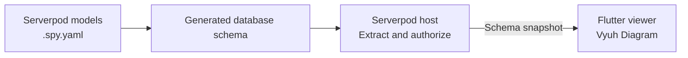

# Serverpod Lens

**See how your Serverpod backend fits together.**

Lens turns the schema generated from your `.spy.yaml` models into an interactive,
read-only map. Find a table, understand its fields, and follow its connections
without losing your place in a large backend.

[Try the demo](https://serverpod-lens.serverpod.space/) ·
[Run locally](serverpod_lens_server/README.md) ·
[Project description](docs/PROJECT_DESCRIPTION.md)

Demo username: `test` — password supplied with the submission. The hosted demo
currently runs an earlier release; the latest UI is available locally.

## Explore your schema

- **Browse:** All schemas → schema → tables. Search by table, model or field.
- **Follow connections:** select a table to highlight its neighbors and dim unrelated nodes.
- **Inspect:** Details, searchable Fields, Relationships, Indexes and authored Source.
- **Stay in control:** resize or collapse either panel, drag tables, fit the view,
  use the minimap and refresh manually. Table cards show every column.
  Choose System, Light or Dark appearance.


[Light mode preview](docs/schema-map-light.png)

## How it works



Serverpod handles authentication and schema delivery. A shared Dart reader
preserves tables, fields, keys and metadata. Vyuh provides native rendering,
layout, selection, effects and navigation. Lens adds schema browsing and inspection.
Moving a table changes the view; model definitions and database contents stay untouched.

Embed **`SchemaViewer(graph: graph)`** in a Flutter host and supply your project's
schema graph. The included host demonstrates the connection; the offline demo
also accepts Serverpod project files and PostgreSQL SQL.

## Reusable packages

| Package | Role |
| --- | --- |
| [serverpod_lens](serverpod_lens/) | Reusable Flutter viewer and import adapters |
| [serverpod_lens_schema](serverpod_lens_schema/) | Plain Dart schema graph and definition reader |

The sample backend, generated client and connected/offline apps stay in this
repository as integration examples; they do not need separate package releases.
The [shop example](serverpod_lens/example/) shows four Serverpod models embedded
in the viewer using a schema compiled by Serverpod itself.

**Distribution:** both reusable packages are currently available from Git.
The schema package can be released to pub.dev; the viewer requires a custom
registry while its licensed Vyuh extensions remain on `pub.vyuh.tech`.
Neither package has been published. See [installation](serverpod_lens/README.md).

## Try it locally

Requires Flutter 3.47+, Dart 3.13+ and access to Vyuh's licensed extensions.
Follow the [setup guide](serverpod_lens_server/README.md), then:

```sh
flutter pub get
cd serverpod_lens_server
serverpod start
```

Open **http://localhost:8092**. Verify with `tool/verify.sh` from the repository root.

**Verified locally:** 141 tests pass; Dart analysis is clean. The reader is checked
against all 19 database column types in Serverpod 4.0.4.
[Results and limits](docs/VERIFICATION.md) · [Security review](docs/SECURITY_REVIEW.md)

**The goal:** make understanding a backend a natural part of writing Serverpod
models. Lens is currently a repository package and sample integration; publication
and integration into official Serverpod development tools are future steps.

Lens source is licensed under [MIT](LICENSE). Vyuh extensions retain their own
license and access requirements.

[Architecture](docs/PLAN.md) · [Deployment](docs/DEPLOYMENT.md)
