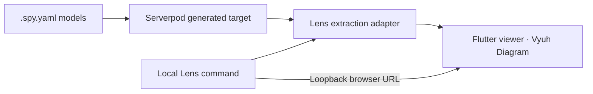

# Serverpod Lens

**Understand your Serverpod models without leaving your development workflow.**

Lens turns a project's generated schema into an interactive, read-only map.
Find a table, inspect its fields and source, and follow its connections.
It uses Serverpod's current generated target—not application records.

## Open your schema locally

From either example's server folder:

```sh
serverpod run lens
```

Lens prints a local browser URL. **No login, Cloud account or running project
server is required.** Refresh manually after Serverpod regenerates your models.
The first launch builds the shared Flutter viewer; later launches reuse it.


Browse **All schemas → schema → tables**. Select a table to emphasize its
connections and inspect Details, Fields, Relationships, Indexes and Source.
Drag tables, choose a native layout, resize or collapse the panels, use the
minimap, and switch between System, Light and Dark.

## How it works



Serverpod resolves model types and relationships. Lens preserves tables, fields,
keys, indexes and source metadata. Vyuh handles native rendering, layout,
selection, effects, pan/zoom and the minimap. Moving a table changes only its view.

## Packages

| Package | Responsibility |
| --- | --- |
| [serverpod_lens](serverpod_lens/) | Reusable Flutter viewer; embed `SchemaViewer(graph: graph)` |
| [serverpod_lens_schema](serverpod_lens_schema/) | Plain Dart graph and resolved-definition reader |
| [serverpod_lens_backend](serverpod_lens_backend/) | Shared Serverpod target and source extraction |
| [serverpod_lens_cli](serverpod_lens_cli/) | Local launcher and browser link |

These are repository packages; none has been published. The viewer's licensed
Vyuh extensions require registry access. See [installation](serverpod_lens/README.md)
and [CLI setup](serverpod_lens_cli/README.md). Lens code is [MIT licensed](LICENSE).

## Two Serverpod examples

- **[Shop](examples/shop/):** four authored models—customers, products, orders and
  order items—plus Serverpod's framework tables. Demonstrates local extraction.
- **[Large schema](examples/large_schema/):** 156 tables. Also contains the optional
  connected Cloud demo with Serverpod authentication and project read scopes.

Both projects use the same extraction and viewer packages. Their generated
server/client code belongs to the examples, not the reusable viewer.

```text
serverpod_lens/           Flutter viewer package
serverpod_lens_schema/    Plain Dart schema contract
serverpod_lens_backend/   Serverpod extraction package
serverpod_lens_cli/       Local launcher and shared tooling viewer
examples/
  shop/                  Serverpod server + generated client
  large_schema/          Serverpod server + client + optional Cloud app
```

The root `pubspec.yaml` manages all packages and examples as one workspace.

Requires Flutter 3.47+, Dart 3.13+, Serverpod 4.0.4 and Vyuh extension access:

```sh
flutter pub get
cd examples/shop/server
serverpod run lens
```

Verify from the repository root with `tool/verify.sh`.
[Verification](docs/VERIFICATION.md) · [Architecture](docs/PLAN.md)

## Optional public demo

[Try the Cloud demo](https://serverpod-lens.serverpod.space/).
Cloud is for demonstration; it is not required to use Lens. The hosted demo
runs an earlier release and requires its read-only judge account. No deployment
is part of this restructure. [Demo access and deployment](docs/DEPLOYMENT.md).

**The goal:** make understanding a backend a natural part of writing Serverpod models.
[Project description](docs/PROJECT_DESCRIPTION.md)
