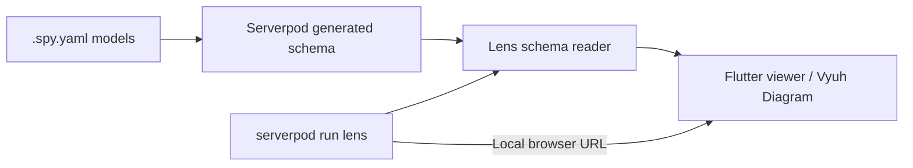

# Serverpod Lens

**Understand the backend your Serverpod models create.**

Lens turns Serverpod's generated schema into an interactive, read-only map.
Browse schemas and tables, inspect fields and keys, and follow relationships.
It reads model definitions, never application records.

## Try the demo

[Open Serverpod Lens](https://serverpod-lens.serverpod.space/) — explore a
156-table example hosted on Serverpod Cloud.

**Demo login:** username `test`, password `test123!`.

This URL stays the same when we deploy updates to the same Cloud project.
Cloud and authentication are only needed for the shared demo.


## Run locally

From the repository root:

```sh
flutter pub get
cd examples/shop/server
serverpod run lens
```

Open the browser URL printed in the terminal. Local Lens requires no login,
Cloud account, running application server or database. Refresh manually after
Serverpod regenerates your models.

Requires Flutter 3.47+, Dart 3.13+, Serverpod 4.0.4 and
[Vyuh extension access](packages/serverpod_lens/README.md).
[Local tool setup](tool/lens/README.md).

## How it works



Serverpod resolves the models; Lens exposes their structure; Vyuh provides the
native diagram, layouts, connections, zoom and minimap. Moving a table changes
only its position in the view.

Browse **All schemas → schema → tables**. Select a table to highlight its
connections and inspect Details, Fields, Relationships, Indexes and Source.
Both panels collapse and resize. Choose automatic layouts or arrange tables
manually, and switch between light and dark themes.

## Packages

| Package | Role |
| --- | --- |
| [serverpod_lens](packages/serverpod_lens/) | Reusable Flutter viewer: `SchemaViewer(graph: graph)` |
| [serverpod_lens_schema](packages/serverpod_lens_schema/) | Plain Dart schema graph, definition reader and snapshot policy |

## Examples

- [Shop](examples/shop/): customers, products, orders and order items, plus framework tables.
- [Large schema](examples/large_schema/): 156 tables and the connected Cloud demo.

Both examples use the same packages. `packages/` contains reusable code;
`examples/` contains Serverpod applications; `tool/lens/` contains the local launcher.

**Our goal:** make schema exploration a native part of the Serverpod development workflow.

[MIT license](LICENSE) · [Architecture](docs/PLAN.md) · [Verification](docs/VERIFICATION.md)
