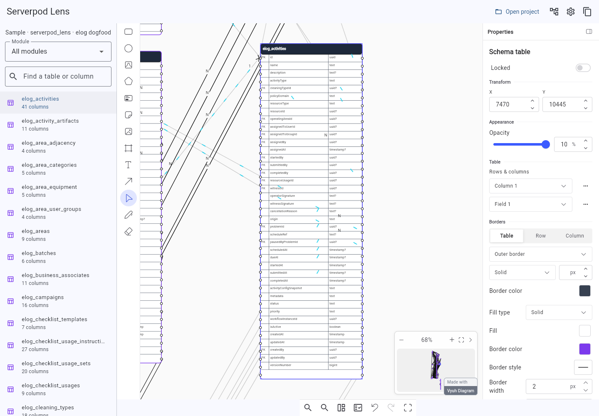

# Serverpod Lens

A read-only schema viewer for Serverpod projects. Browse tables, inspect fields
and indexes, follow foreign keys, and view the model source.

## Try the demo

[Open the Cloud demo](https://serverpod-lens.serverpod.space/).
Sign in with username `test` and password `test123!`.

The Cloud demo explores a fictional university campus with 156 tables and uses
Serverpod authentication.


## Run locally

Requires Flutter 3.47+, Dart 3.13+, Serverpod 4.0.4, and access to
[Vyuh's licensed diagram extensions](packages/serverpod_lens/README.md).

From the repository root:

```sh
dart pub token add https://pub.vyuh.tech
flutter pub get
cd examples/shop/server
serverpod run lens
```

Open the loopback URL printed in the terminal. Local Lens reads the project's
generated schema without starting its server or connecting to its database.
After Serverpod regenerates your models, click Refresh to load the changes.

The launcher runs from this checkout. See [local tool setup](tool/lens/README.md).

## Explore a schema

- Search for a table or column, or browse **All schemas → schema → tables**.
- Select a table to highlight its relationships and inspect its fields, keys,
  indexes, and model source.
- Follow incoming and outgoing relationships from the inspector.
- Choose a layout, move tables, and adjust the minimap, connections, and theme.

Moving tables changes the view. Model definitions and database records remain
unchanged.

## Packages and examples

Both packages are published as **0.1.0** on
[pub.vyuh.tech](https://pub.vyuh.tech) in the **internal** tier. Installing them
requires registry access. See each package's README for the hosted dependency
declaration and API examples.

| Path | Contents |
| --- | --- |
| [serverpod_lens](packages/serverpod_lens/) | Flutter viewer and host integration |
| [serverpod_lens_schema](packages/serverpod_lens_schema/) | Plain Dart schema graph, reader, and snapshots |
| [Shop example](examples/shop/) | Customers, products, orders, and order items |
| [Large-schema example](examples/large_schema/) | 156-table university campus project and connected Cloud host |
| [Local launcher](tool/lens/) | CLI and browser host |
| [Optional imports](tool/lens/imports/) | ZIP, YAML, and PostgreSQL SQL adapters |

Serverpod supplies the resolved database schema. Lens maps it to a graph, and
Vyuh Diagram renders the tables and connections. See [architecture](docs/PLAN.md).

## Development

After installing workspace dependencies, run:

```sh
tool/verify.sh
```

This runs analysis, formatting checks, and the Dart/Flutter test suites. Server
tests use managed embedded PostgreSQL. The verification workflow runs these
checks, PostgreSQL parser tests, and public dependency advisory checks on pushes
to `main` and pull requests.
Server tests need a test database password in the local Serverpod configuration
or `SERVERPOD_PASSWORD_database`; CI supplies a disposable test-only value.

Package publication uses the manual
[Publish internal Lens packages workflow](.github/workflows/publish-packages.yml).
It defaults to a dry run. Publishing requires a `PUB_VYUH_TOKEN` secret with
`package:publish` permission; a repository secret overrides one with the same
name at organization level.

To rebuild the Cloud demo from the published packages, run
`dart run tool/build_cloud_release.dart`. It prepares an isolated build outside
the checkout and prints the deployment directory. See the
[Cloud build instructions](examples/large_schema/README.md#cloud-demo).

Lens code is [MIT licensed](LICENSE). Third-party dependencies retain their own
licenses.
