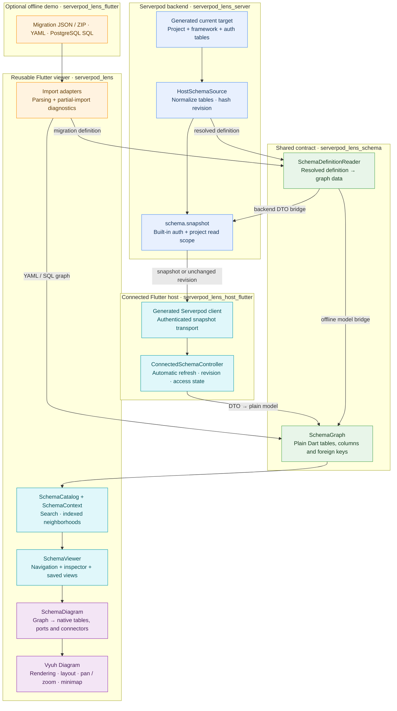

# Serverpod Lens

A read-only schema explorer for Serverpod. Find tables and columns, follow foreign
keys, and focus on the relationships that matter in a large project.

[Hosted demo](https://serverpod-lens.serverpod.space/) · Read-only demo username: `test`
(password supplied separately).

Lens works alongside Serverpod infrastructure: the backend supplies its resolved
schema and enforces access; the Flutter host manages sessions and refresh; the
reusable viewer displays a plain Dart graph using Vyuh Diagram.


[Light mode preview](docs/schema-map-light.png)

## Architecture

The diagram shows schema data flowing through the connected host and the optional
offline demo. The backend and offline import adapters use the same definition
reader; generated transport models stay outside the viewer.



## Responsibilities

| Package | Owns |
| --- | --- |
| `serverpod_lens_schema` | Plain Dart graph model and shared Serverpod definition reader; no Flutter or Serverpod runtime dependency |
| `serverpod_lens` | Import adapters, schema queries, diagram mapping and `SchemaViewer`; no generated client or backend connection |
| `serverpod_lens_server` | Built-in authentication, project authorization, target extraction and revision-based schema delivery |
| `serverpod_lens_client` | Generated transport models and endpoint client |
| `serverpod_lens_host_flutter` | Sign-in, client initialization, refresh and connection state; converts transport data to the plain graph |
| `serverpod_lens_flutter` | Offline file picking, SQL input, bundled sample and app theme |

Vyuh supplies native table rendering, connectors, layout and canvas gestures.
Lens maps schema meaning onto those primitives. Moving tables changes the view;
it never changes models or the database.

The connected and offline hosts use the same viewer. Backend access and
authentication stay in the host; navigation, view persistence and native diagram
mapping stay in the viewer.

## Embed the viewer

Pass a graph from your host, or convert a complete Serverpod migration definition:

```dart
import 'package:serverpod_lens/serverpod_lens.dart';

final graph = SchemaExtractor.fromDefinitionJson(
  resolvedDefinitionJson,
  source: 'My Serverpod project',
);

SchemaViewer(graph: graph)
```

For a connected host, obtain the target through its protected Serverpod endpoint
and pass the decoded graph to the same widget. The included endpoint exposes its
own project's generated target. Connecting another project requires an adapter
in that project's backend; importing a ZIP opens an offline snapshot.

The connected host loads once after sign-in and updates when you press Refresh.
Both unchanged and changed snapshots preserve valid search, selection, camera
and manual positions. Removed models are pruned. Temporary network failures keep
the last valid graph with an error; access denial and sign-out remove protected
content.

## Run with Serverpod

Requires Flutter 3.47+, Dart 3.13+ and access to Vyuh's commercial extensions.
Configure the publisher-issued registry token, then install workspace dependencies:

```sh
dart pub token add https://pub.vyuh.tech
flutter pub get
cd serverpod_lens_server
serverpod start
```

Serverpod manages the development database, code generation and connected Flutter
app. Open `http://localhost:8092` and create an account using built-in email auth.
Development verification codes appear in the server logs. New accounts need an
operator grant before viewing the schema. From the server package, the owner runs:

```sh
dart run bin/grant_schema_access.dart <account-uuid>
```

Sign out and back in to receive the project scope. For the independent offline
demo, run `flutter run -d chrome` from `serverpod_lens_flutter` instead.

## Explore a large schema

- Browse **All schemas → schema → tables**. Expand/collapse arrows control the
  tree independently; clicking a schema opens its overview. Search tables and fields.
- **All schemas** shows the complete map and connections; selecting a schema
  shows every table in that database schema. Serverpod modules remain metadata.
- Select a table from the tree or map to highlight it and its immediate neighbors.
  Unrelated nodes fade; native dashes flow toward connected neighbors. Clicking
  a node preserves pan and zoom; tree navigation brings its table into view.
- The inspector separates **Details**, **Fields**, **Relationships**, **Indexes**
  and **Source**. Fields has search and type/key badges. Relationship links select
  their destination; Source shows the filename, path, code and open action.
- Clearing selection restores the overview and keeps the desktop inspector space
  stable. Phones open the same inspector in a bottom sheet.
- Compact native cards show primary and foreign keys; the complete field metadata
  remains in the inspector. Connectors anchor to actual key rows.
- Drag tables after native automatic layout. Positions are saved per host account.
- Fit, Auto layout, Refresh, Settings and Sign out are available in the header.
  Enabling the native minimap shows its expanded map and zoom controls.
- Choose **System**, **Light** or **Dark** in Settings → Appearance. The same
  persisted theme applies to authentication and both connected/offline hosts.

Authored `.spy.yaml` files can be previewed and opened through a host callback.
The included connected host opens repository source; an embedding host can supply
an IDE action. Framework tables and SQL-only imports may have no model source.
The supplied dataset is a fixture: Lens receives the host project's own generated
schema. All 19 column types in Serverpod 4.0.4 are covered by contract tests, and
complete resolved table metadata is retained in the inspector, including advanced
index/constraint attributes and vector dimensions.

The generated Serverpod target remains authoritative. YAML-only imports disclose
partial inference; migration ZIP imports prefer resolved definitions.

The connected integration targets Serverpod 4.0.4. It reads the generated target,
not the live database catalog. Migration comparison, upstream development-tool
installation and package publication remain future work.

## Verify locally

```sh
tool/verify.sh
```

Set `FLUTTER_BIN` and `DART_BIN` if the SDK is outside PATH. The runner checks
analysis, formatting and all five Dart/Flutter package suites. Backend tests use
managed embedded PostgreSQL and need no Docker. See the verification report for
measured coverage and remaining browser/device checks.

## Further reading

- [Architecture and integration plan](docs/PLAN.md)
- [Deployment and judge access](docs/DEPLOYMENT.md) · [Project description](docs/PROJECT_DESCRIPTION.md)
- [Verification results](docs/VERIFICATION.md) · [Security review](docs/SECURITY_REVIEW.md)
- [Sample dataset provenance](docs/elog-schema.md)

Vyuh extensions require their own license/entitlement. PostgreSQL parser notices
ship in `serverpod_lens/assets/sql/`. No project license has been declared.
