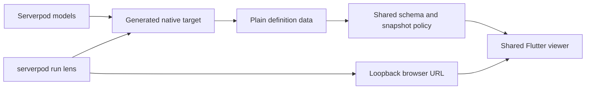

# Architecture

Lens reads a configured Serverpod project's generated database target and presents
it through a shared Flutter viewer. The local workflow uses a loopback browser;
the authenticated Cloud app is an optional example.

## Two reusable packages

| Module | Interface | Responsibility |
| --- | --- | --- |
| `serverpod_lens_schema` | `SchemaExtractor`, `LensSchemaSource`, `LensSchemaSnapshot`, `LensSnapshotState` | Plain definition mapping, qualified identities, deterministic revisions and snapshot validation |
| `serverpod_lens` | `SchemaViewer`, `SchemaSnapshotController`, theme controls | Shared exploration UI, request lifetime and native Vyuh presentation |

The schema package depends on public Dart libraries. Its primary entry point has
no Flutter, Serverpod SDK or filesystem import. `io.dart` explicitly provides
bounded authored-source indexing. Advanced native diagram integration is available
from the viewer's `diagram.dart`; ordinary hosts use `SchemaViewer`.

## Internal tools and examples

```text
packages/
  serverpod_lens_schema/
  serverpod_lens/
tool/lens/
  bin/ + lib/            internal Dart launcher
  viewer/                shared browser host
  imports/               optional ZIP/YAML/SQL adapters and preserved tests
examples/
  shop/server + client
  large_schema/server + client + flutter
```

Internal tools and example applications retain their workspace manifests. They
have no independent publication planned. Generated code belongs to the examples.
The Shop example has four authored models; the large fixture has 156 target tables
and an optional authenticated host. Both use the same schema interpretation.

## Local flow



The configured Serverpod script starts only Lens. A utility imports the project's
own `Protocol` and serializes its current definitions. The CLI passes plain maps to
the schema package; no second native model decoder is installed in that path.
Application server startup and database access are unnecessary for local viewing.

Initial HTTP delivery reuses the startup snapshot. Manual Refresh rereads the native
target and authored sources, including dependency changes; overlapping requests
share one read. Equal revisions omit graph/source bodies. Both Flutter hosts use
one snapshot controller to validate project identity, retain unchanged graph state,
handle request overlap/disposal and preserve valid state after ordinary failures.
The Cloud adapter alone classifies access failures and clears protected state.

The internal web build uses a content fingerprint of viewer/package source,
manifests, the dependency lockfile and Dart version. A stale build is rebuilt into
clean output, preventing removed assets from surviving Flutter incremental builds.
`--rebuild` remains available, including for Flutter-only SDK changes. Explicit
`--web-dir` builds are operator supplied and bypass automatic build checks.

## Native Vyuh ownership

Vyuh supplies table shapes, field ports, connectors, layouts, dragging, selection,
transient effects, camera bounds, grid and minimap. Lens maps schema semantics and
owns the surrounding browser/inspector. It does not install an editable schema UI
or a custom diagram renderer.

All schemas → schema → tables is the navigation hierarchy. Selection emphasizes
the table and its immediate connections; solid lines remain beneath outward
marching dashes. One native effect path owns emphasis. Closing/collapsing/resizing
panels, searchable fields, source display and System/Light/Dark remain shared UI.
Moving shapes changes view geometry, never the project's models or records.

## Optional imports and Cloud

ZIP/YAML/SQL parsing is internal optional tooling. Its worker/WASM assets and license
notices are outside the native viewer. YAML inference remains explicitly partial;
Serverpod's generated database target is authoritative. Non-table model inventory
and enum declarations are not supplied by the current target-table extraction.

The optional Cloud example owns built-in Serverpod authentication, project read
scopes and generated transport. The shared schema package contains no auth scope
or endpoint. Cloud deployment and package publication require separate authorization.

## Architecture audit — 2026-10-14

The audit at `29ec3f7` led to these completed changes:

- Removed the separately packaged backend; retained one neutral extraction implementation.
- Relocated the CLI/browser host to internal tooling and isolated optional imports.
- Shared snapshot validation and refresh lifetime across local and Cloud hosts.
- Removed the obsolete document-opacity emphasis path; preserved native effect coverage.
- Added dependency/equal-timestamp refresh regressions and actual native subprocess coverage.
- Removed the inline IDE password and corrected example launch paths.
- Added build content invalidation, clean output and sanitized local failure reporting.

The removed IDE credential remains in older Git history; it was not rotated by
these source changes. Large full maps still have measured native SDK performance
limits. Native Layered is disabled on web scopes of at least 100 tables; Force has
a bounded iteration budget. The SDK's generic connection hover decoration remains.
Cross-version Serverpod compatibility, standalone CLI distribution, production
Cloud verification and a literal upstream `serverpod lens` command remain future
work. See [verification](VERIFICATION.md) and [security review](SECURITY_REVIEW.md).
